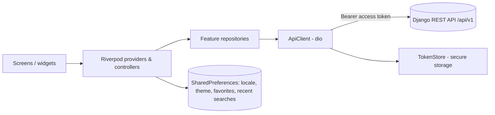

# AlEyada Mobile — العيادة

Flutter mobile client for the AlEyada medical directory. Patients find doctors,
book appointments and manage their bookings; approved doctors get a management
area for their clinics, assistants and schedule.

The app is a **client of an existing Django REST API and nothing else**. It has no
backend of its own and holds no business rules: the server decides, the app
presents the result. The API contract is checked in as
[`Aleyada API.yaml`](<Aleyada API.yaml>) (OpenAPI 3.0.3, "Aleyada API" 1.0.0).

| | |
|---|---|
| App version | `1.0.0+1` (`pubspec.yaml`) |
| Dart SDK | `^3.12.2` |
| Flutter | `>=3.44.0` per `pubspec.lock`; CI is pinned to `3.44.8` stable |
| Platforms | Android (configured, signed-release capable), iOS (configured, see [iOS](#ios)) |
| Languages | Arabic (template, default product language) and English, with full RTL support |
| Default backend | `https://aleyada.scenariomnchnl.tech/api/v1` |
| License | Not specified — see [License](#license) |

## Table of contents

- [Overview](#overview)
- [Key features](#key-features)
- [Screenshots](#screenshots)
- [Technology stack](#technology-stack)
- [Architecture](#architecture)
- [Project structure](#project-structure)
- [Prerequisites](#prerequisites)
- [Installation and setup](#installation-and-setup)
- [Running the app](#running-the-app)
- [Configuration](#configuration)
- [API and backend integration](#api-and-backend-integration)
- [Local storage and offline behavior](#local-storage-and-offline-behavior)
- [Testing and code quality](#testing-and-code-quality)
- [Build and release](#build-and-release)
- [Troubleshooting](#troubleshooting)
- [Security](#security)
- [Known limitations and unbuilt features](#known-limitations-and-unbuilt-features)
- [Contributing](#contributing)
- [License](#license)
- [Links](#links)

## Overview

AlEyada is a medical directory. This repository is its native mobile client.

- **Patients** (and signed-out visitors) browse specialties, doctors and medical
  centers, read doctor profiles and reviews, and see published articles. Signed-in
  patients book appointments, track and cancel bookings, and keep favorite doctors.
- **Doctors** can apply to join from the app. Once an administrator approves the
  application, a **Management** tab appears with practice statistics, clinics,
  assistants and the appointment schedule.

All rules (booking constraints, cancellation windows, which cities accept doctor
registration, roles) live on the server. The app sends requests and renders the
answers.

## Key features

**Discovery**
- Home screen with a hero, quick discovery, specialties, doctors, medical centers
  and articles (`lib/features/home/`).
- Doctor search with filters and recent searches (`lib/features/doctors/`).
- Doctor profiles with services, clinics, availability and reviews.
- Favorite doctors, stored on the device per account (`lib/features/favorites/`).
- Call and WhatsApp actions using the links the API returns (`url_launcher`).

**Accounts and sessions**
- Patient sign-up with phone OTP verification, sign-in, forgot/reset password.
- Policy consent flow; the router forces re-acceptance when the server requires it.
- Secure session restore at launch; a network outage never signs the user out
  (see [Authentication](#authentication-and-sessions)).
- Account screens: edit account details, language, and appearance
  (System / Light / Dark).

**Bookings**
- Pick an availability slot and book from the doctor profile.
- "My bookings" list and detail with status timeline; cancellation is offered
  only when the booking's own `can_cancel` is true.
- Booking times use the backend's `display_time` / `display_date`, formatted in
  the clinic's timezone.

**Doctor onboarding and management**
- "Join as a doctor" application (`/auth/register/doctor-request/`) and
  application-status display.
- Approved doctors: Management hub with statistics, clinics (terms, opening hours,
  invitations), assistants, and schedule (appointments and weekly availability).
- Doctor profile viewing/editing screens (`lib/features/profile/`).

**Notifications**
- In-app notifications list with read / read-all and unread count. Push
  notifications are **not** implemented (see [limitations](#known-limitations-and-unbuilt-features)).

**Experience**
- Arabic-first, RTL-correct UI; bundled Cairo and Poppins fonts.
- Light and dark themes built on a `ThemeExtension` palette with WCAG AA checks.
- Animated launch splash.

## Screenshots

No screenshots or demo videos are committed to this repository, so none are shown
here. Add them under a folder such as `docs/screenshots/` and link them here when
available.

## Technology stack

| Area | Technology | Purpose |
|---|---|---|
| Framework | Flutter / Dart (`sdk: ^3.12.2`) | UI and app logic |
| State management | `flutter_riverpod` ^2.6.1 | Single state/DI approach throughout |
| Navigation | `go_router` ^14.6.2 | Declarative routes with auth guards |
| HTTP | `dio` ^5.7.0 | One client with auth/refresh and error-mapping interceptors |
| Secret storage | `flutter_secure_storage` ^9.2.2 | Access/refresh tokens (Android Keystore / iOS Keychain) |
| Preferences | `shared_preferences` ^2.3.3 | Non-secret UI state (see [storage](#local-storage-and-offline-behavior)) |
| Localization | `flutter_localizations`, `intl` ^0.20.2, gen-l10n | Arabic/English ARB files |
| Links | `url_launcher` ^6.3.1 | `tel:`, WhatsApp and web links |
| Lints | `flutter_lints` ^5.0.0 | Static analysis rules |
| Test HTTP | `http_mock_adapter` ^0.6.1 | Answer HTTP in tests without a network |
| Backend | Django + DRF (external, not in this repo) | REST API, JWT authentication |

Backend technology is taken from the app's own documentation and the OpenAPI file;
the backend source is not part of this repository.

## Architecture

The app follows a layered, feature-first layout. There is no code generation for
state or models; DTOs are hand-written with tolerant parsers.



- **Bootstrap** (`lib/main.dart`): reads the saved theme mode and locale before the
  first frame, builds a `ProviderContainer`, and starts session restoration
  (`authControllerProvider.notifier.restore()`) before `runApp`.
- **Dependency injection** (`lib/core/providers.dart`): `tokenStoreProvider`,
  `sessionExpiryProvider` and `apiClientProvider` form the object graph. Tests
  override these to swap in a mock transport.
- **Networking** (`lib/core/api/`): `ApiClient` wraps dio; `endpoints.dart` is the
  single list of every route the app calls; `envelope.dart` and `api_error.dart`
  handle the response envelope and typed errors; `error_messages.dart` maps backend
  error `code` to localized text.
- **Features** (`lib/features/<name>/`): each feature has `models.dart`,
  `repository.dart` and `providers.dart` where it talks to the API, plus screens
  and widgets.
- **Routing** (`lib/app/router.dart`): a `GoRouter` provider with a
  `refreshListenable` tied to the auth state. The redirect logic:
  - holds everyone on `/splash` until session restore and the launch animation finish;
  - forces `/consent` when the user must re-accept policies;
  - sends signed-out users away from protected routes (`/bookings`, `/account`,
    `/account/edit`, `/notifications`, `/practice`, `/management`) to
    `/sign-in?next=…`;
  - keeps signed-in users out of `/sign-in` and `/sign-up`;
  - restricts `/management/*` to active doctors; `/practice` redirects to `/management`.
  The tabbed area (home, doctors, bookings, favorites, management, account) uses a
  `ShellRoute` so the bottom bar persists.
- **Theming** (`lib/core/theme/`): colors are semantic roles exposed through
  `context.palette` (a `ThemeExtension`), not raw values.

### Business rules stay on the server

- Doctor-onboarding cities come from `/locations/cities/?onboarding=1`; search uses
  the unrestricted `/locations/cities/`.
- Cancellation uses the booking's `can_cancel`; the app never recomputes the cutoff.
- Booking constraints (lead time, clashes, limits) are enforced server-side.
- Money is handled as a decimal string, not a `double`.
- Errors branch on the backend's `code`, never on its message text.
- Management routes are guarded on an active doctor profile, and the endpoints
  behind them are doctor-gated server-side.

## Project structure

```text
.
├── Aleyada API.yaml        OpenAPI 3.0.3 spec of the backend
├── analysis_options.yaml   flutter_lints
├── l10n.yaml               gen-l10n config (Arabic ARB is the template)
├── pubspec.yaml / .lock
├── assets/
│   ├── logo.png            app logo used on auth screens
│   ├── fonts/              Cairo (variable), Poppins, OFL license
│   └── brand/              placeholder (.gitkeep only)
├── ci/                     GitHub Actions workflow (not yet enabled) + notes
├── android/                Android project (Kotlin DSL Gradle, applicationId com.aleyada.app)
├── ios/                    iOS project (Runner)
├── lib/
│   ├── main.dart           bootstrap
│   ├── app/                app widget, router + guards, shell/bottom nav,
│   │                       splash gate, locale and theme-mode controllers
│   ├── core/
│   │   ├── api/            ApiClient, endpoints, envelope, ApiError
│   │   ├── auth/           TokenStore, AuthController/Repository, models, session expiry
│   │   ├── config/         Env (--dart-define values)
│   │   ├── errors/         backend code → localized message
│   │   ├── theme/          palette, theme, tokens
│   │   ├── utils/          Arabic text, contact links, media URLs, debouncer
│   │   └── widgets/        async view, form fields
│   ├── features/
│   │   ├── articles/  auth/  bookings/  clinics/  doctors/  favorites/
│   │   ├── home/  management/  notifications/  onboarding/  practice/
│   │   └── profile/  splash/
│   └── l10n/               app_ar.arb (template), app_en.arb, generated localizations
└── test/
    ├── fixtures/           response bodies and fakes
    ├── unit/               parsers, logic, auth/session, theme guards
    └── widget/             screen tests with a shared harness
```

## Prerequisites

- **Flutter** `3.44.x` stable (CI uses `3.44.8`) with Dart `>=3.12.2 <4.0.0`.
- **Android**: Android SDK and a JDK (CI uses Temurin 17). `minSdk` follows
  Flutter's default (`flutter.minSdkVersion`).
- **iOS** (optional): macOS with Xcode and CocoaPods. Deployment target is 13.0
  (`IPHONEOS_DEPLOYMENT_TARGET` in the Xcode project).
- A reachable AlEyada API. The default is the deployed host; to develop against a
  local backend you need that backend running (it is not in this repository, and
  its setup is not documented here).

## Installation and setup

```bash
git clone https://github.com/indoo24/AlEyadaMobileApp.git
cd AlEyadaMobileApp
flutter pub get
flutter gen-l10n      # only needed after editing lib/l10n/*.arb
```

The generated localization files (`lib/l10n/app_localizations*.dart`) are
committed, so a fresh clone builds without running `gen-l10n`.

No `.env` file, API key or Firebase configuration is used. Configuration is passed
at build/run time with `--dart-define` (see [Configuration](#configuration)). The
repository contains no `google-services.json` or `GoogleService-Info.plist`, and no
Firebase dependency.

## Running the app

Against the default (deployed) backend:

```bash
flutter run
```

Against a local backend from the Android emulator (`10.0.2.2` is the emulator's
route to the host machine):

```bash
flutter run \
  --dart-define=ALEYADA_ENV=development \
  --dart-define=ALEYADA_API_BASE_URL=http://10.0.2.2:8000/api/v1 \
  --dart-define=ALEYADA_VERBOSE_LOG=true
```

Cleartext HTTP is permitted only in **debug** builds, and only to `10.0.2.2`,
`localhost` and `127.0.0.1` (`android/app/src/debug/res/xml/network_security_config.xml`).
Release builds refuse cleartext. Physical devices need an HTTPS URL or an
address you add to that debug config.

## Configuration

All configuration is compile-time, via `--dart-define`, and read in
`lib/core/config/env.dart`. None of it is secret.

| Variable | Default | Required | Purpose |
|---|---|---|---|
| `ALEYADA_ENV` | `production` | No | `development` or `production`. Anything other than `development` is treated as production. |
| `ALEYADA_API_BASE_URL` | `https://aleyada.scenariomnchnl.tech/api/v1` | No | API root including `/api/v1`. |
| `ALEYADA_MANAGEMENT_URL` | `https://scenariomnchnl.tech/` | No | Address opened by the doctor's "open management system" button. An empty or non-http(s) value hides the button. |
| `ALEYADA_VERBOSE_LOG` | `false` | No | Verbose request logging; ignored in production. Logs method and path only. |

Fixed values in code: connect timeout 15 s, receive timeout 20 s.

Other configuration files:

| File | Purpose |
|---|---|
| `l10n.yaml` | gen-l10n: `lib/l10n`, template `app_ar.arb`, class `L` |
| `analysis_options.yaml` | Includes `package:flutter_lints/flutter.yaml` |
| `android/key.properties` | **Optional, git-ignored.** Release signing (see [Android signing](#android-release-signing)) |

## API and backend integration

- **Base URL**: `Env.apiBaseUrl`. All routes are listed, with comments, in
  `lib/core/api/endpoints.dart`; anything not listed there is not called.
- **Contract**: `Aleyada API.yaml` (OpenAPI). DTO tests parse response bodies
  captured from the real API (`test/fixtures/api_fixtures.dart`).
- **No BFF**: the web client has its own Next.js routes (`/api/auth/*`,
  `/api/staff/*`); this app does not use them. The backend's authentication is JWT
  (a `Bearer` access token in the `Authorization` header), so CSRF does not apply.

Endpoint groups used (see `endpoints.dart` for the full list): auth and OTP,
legal policies and consents, locations, specializations, doctors, clinics, home,
articles, bookings, notifications, tracking (contact click), and the doctor's own
profile, clinics, assistants, availability, schedule and statistics.

### Authentication and sessions

| Behaviour | Implementation |
|---|---|
| Sign in | `POST /auth/login/` → access + refresh tokens stored in secure storage |
| Sign up | `POST /auth/register/patient/`, then OTP via `/auth/otp/verify/`; verifying also signs the user in |
| Restore | One `GET /auth/me/` at launch; the router shows the splash until it settles |
| Refresh | On `401`, a single-flight refresh (`/auth/token/refresh/`), then the original request is replayed |
| Rotation | The refresh token is rotated by the backend; the new value is stored |
| Sign out | `POST /auth/logout/`; local state is cleared regardless of the result |

Three outcomes are kept distinct: no token (signed out), token rejected (signed
out, storage cleared), and token unverifiable because of a network failure (the
session is kept and a retry is offered).

### Error handling

`ApiClient` maps responses to typed `ApiError`s; UI messages come from
`lib/core/errors/error_messages.dart`, keyed on the backend's error `code`.

### Real-time communication

None. There is no WebSocket or server-sent-events code in `lib/`.

## Local storage and offline behavior

| Data | Store | Key / notes |
|---|---|---|
| Access and refresh tokens | `flutter_secure_storage` | `aleyada.access`, `aleyada.refresh` |
| Theme mode | `shared_preferences` | `aleyada.theme_mode` |
| Locale | `shared_preferences` | `aleyada.locale` |
| Recent searches | `shared_preferences` | `recent_doctor_searches_v1:<userId or guest>` (max 8) |
| Favorite doctors | `shared_preferences` | per account; stores doctor id and slug only |

There is no offline data cache and no offline-first mode. Offline behavior is
limited to keeping a valid session when the network is unavailable at launch.

## Testing and code quality

```bash
flutter analyze
flutter test
dart format --line-length 100 lib test
```

CI additionally checks that `lib/l10n/` is current and that formatting is clean:

```bash
flutter gen-l10n && git diff --exit-code lib/l10n/
dart format --line-length 100 --set-exit-if-changed lib test
```

Test layout (`test/`):

- `unit/` — API errors and token refresh, auth/session, booking and doctor logic,
  contract parsing, safe redirects, contact links, schedule/theme controllers,
  palette contrast (WCAG AA) and a theme guard that fails if raw colors are used
  outside `lib/core/theme/`.
- `widget/` — screen tests (auth, home, search, bookings, doctor detail,
  favorites, management, appearance/dark mode, RTL, session isolation) driven
  through the real `ApiClient` with only the HTTP adapter replaced
  (`test/widget/harness.dart`).
- `fixtures/` — captured API bodies and fakes.

There are no integration (device/emulator) tests.

> The commands above are taken from the repository configuration and CI workflow.
> The Flutter SDK was not available in the environment where this README was
> written, so the tests were not run and no pass/fail status is claimed.

## Build and release

Release builds in the project are documented as obfuscated, with debug symbols
kept outside the binary:

```bash
flutter build apk --release --obfuscate --split-debug-info=build/symbols
flutter build apk --release --split-per-abi --obfuscate --split-debug-info=build/symbols
flutter build appbundle --release --obfuscate --split-debug-info=build/symbols
flutter build ipa --release --obfuscate --split-debug-info=build/symbols
```

`--split-debug-info` is required with `--obfuscate`; it writes symbol files to
`build/symbols/` (git-ignored). Keep the symbols of every released build, and decode
obfuscated stack traces with:

```bash
flutter symbolize -i crash.txt -d build/symbols/app.android-arm64.symbols
```

### Android

- Application id / namespace: `com.aleyada.app`.
- Permission: `INTERNET` only. `allowBackup="false"` plus backup/data-extraction
  rules excluding storage.
- Flutter deep linking is disabled (`flutter_deeplinking_enabled=false`).
- `tel:` and `https:` are declared under `<queries>` so `url_launcher` works on
  API 30+.
- R8 minification is enabled (`isMinifyEnabled = true`); rules are in
  `android/app/proguard-rules.pro`.
- `kotlin.incremental=false` in `android/gradle.properties` (documented there as a
  Windows workaround).

#### Android release signing

The build reads `android/key.properties` if present and otherwise falls back to the
debug key, printing a Gradle warning. A debug-signed build runs but cannot be
published. Never commit the keystore or its passwords (`key.properties`, `*.jks`,
`*.keystore` are git-ignored).

```properties
# android/key.properties (do not commit)
storeFile=upload-keystore.jks     # resolved relative to android/
storePassword=<your store password>
keyAlias=<your key alias>
keyPassword=<your key password>
```

The comments in the repository describe the key as a Google Play **upload key**
(Play App Signing signs distributed builds). Back it up outside the working
machine.

### iOS

The iOS project is configured but, per the project's history, **has not been
compiled**: it was developed on Windows. Building requires macOS with Xcode:

```bash
flutter build ipa --release --obfuscate --split-debug-info=build/symbols
```

The repository has no committed `ios/Podfile`; Flutter generates it on the first
iOS build. Bundle identifier in the Xcode project: `com.aleyada.aleyadaMobile`
(differs from the Android application id). `Info.plist` sets `ar`/`en` localizations,
queries schemes `tel`, `https` and `whatsapp`, disables Flutter deep linking, and
has no `NSAllowsArbitraryLoads`. It contains **no** camera or photo-library usage
strings, because the app does not use those capabilities yet. iOS signing
(team, provisioning) is not configured in the repository and must be set up in Xcode.

### CI/CD

`ci/github-actions-ci.yml` is a ready workflow (pinned Flutter 3.44.8, Java 17):
`pub get` → verify l10n → format check → `flutter analyze` → `flutter test` →
`flutter build apk --release` (debug-signed) → upload APK artifact (14 days). It runs
on pushes and pull requests to `main`.

**It is not active.** There is no `.github/workflows/` directory; the file was
parked under `ci/` because the token used to create the repo lacked the `workflow`
scope. See [`ci/README.md`](ci/README.md) to enable it. No release/deployment
automation exists.

## Troubleshooting

| Symptom | Cause / fix |
|---|---|
| Cleartext/connection error to a local backend on a physical device | Cleartext is allowed only to `10.0.2.2`, `localhost` and `127.0.0.1` in debug builds. Use HTTPS or extend the debug network security config. |
| Release build reports `android/key.properties not found` | Expected on a fresh clone: it falls back to the debug key. Create `key.properties` to sign for release. |
| Gradle "Could not close incremental caches" (Windows) | Handled by `kotlin.incremental=false` in `android/gradle.properties`; keep it. |
| `l10n` out of date / missing `L` strings | Run `flutter gen-l10n` after editing `lib/l10n/*.arb`; commit the output (CI checks it). |
| Call / WhatsApp / website buttons do nothing on Android 11+ | Needs the `<queries>` entries already present in `AndroidManifest.xml`; check they were not removed. |
| Obfuscated crash trace is unreadable | Use `flutter symbolize` with the `build/symbols` files of that exact build. |
| Sign-up OTP never arrives | The project documents that the backend only has console/in-memory OTP delivery (no SMS provider). Confirm with the backend team. |
| API calls fail with the default URL | The project notes that DNS/SSL for `aleyada.scenariomnchnl.tech` may not be live; pass `ALEYADA_API_BASE_URL`. Unverified from this repo. |

## Security

- No secrets belong in the app: only the API base URL and environment name are
  compiled in. Authentication uses tokens issued at login.
- Tokens are kept in Keystore/Keychain-backed secure storage, never in
  `SharedPreferences`. Passwords and OTP codes are not persisted.
- Verbose logging is disabled in production and never records headers, bodies or
  query strings.
- Release builds refuse cleartext HTTP; Android backups are disabled.
- Redirect targets after sign-in (`?next=`) are sanitized (`lib/app/safe_redirect.dart`).
- Never commit `android/key.properties`, keystores, provisioning profiles or
  certificates (all are in `.gitignore`).

## Known limitations and unbuilt features

Taken from the project's own notes and verified against the code where possible.

**Backend-dependent**
- **Push notifications**: not implemented. `NotificationRepository.registerDevice`
  (`POST /notifications/devices/`) exists but is not called; there is no Firebase or
  messaging dependency.
- **OTP delivery**: per the project notes, the backend lacks an SMS provider, so
  production self-service sign-up depends on that being configured.
- **Application resubmission**: no endpoint is used for resubmitting a rejected
  doctor application.

**Not built in the app** (endpoints may exist in `endpoints.dart` but have no UI)
- Booking reschedule (`BookingRepository.reschedule` is wired, not called).
- Submitting reviews (`/reviews/create/`, `/reviews/reviewable/`); reviews are read-only.
- Booking payment-proof upload (`/bookings/{id}/payment-proof/`).
- Doctor claim submission (`/doctor/claim-requests/`).
- A standalone browsable clinic list (clinics appear inside doctor profiles).
- Photo upload: `ApiClient.upload` exists, but `image_picker` is deliberately not a
  dependency yet.
- Web-dashboard features such as articles, days off, clinic holidays and
  payment-proof review remain web-only.

**Other**
- Analytics and crash reporting are not configured.
- `assets/brand/` is empty (`.gitkeep`); final store artwork is not in the repo.

## Contributing

1. Branch from the main branch and keep changes focused.
2. `flutter analyze` and `flutter test` must both be clean.
3. Run `dart format --line-length 100 lib test`.
4. User-visible strings go in **both** `lib/l10n/app_ar.arb` (template) and
   `lib/l10n/app_en.arb`; run `flutter gen-l10n` and commit the generated files.
5. Register new endpoints in `lib/core/api/endpoints.dart` with a comment.
6. Do not use raw colors outside `lib/core/theme/`; use `context.palette`. When you
   add a palette role, add it to `test/unit/palette_contrast_test.dart`.
7. If a change seems to need a backend change, raise it in the PR rather than
   working around it in the client.

## License

No license file is present in this repository, so the license has not been
specified. Add a `LICENSE` file to define the terms. (The bundled fonts carry
their own license: see `assets/fonts/OFL.txt`.)

## Links

- Repository: <https://github.com/indoo24/AlEyadaMobileApp>
- Default API base URL: `https://aleyada.scenariomnchnl.tech/api/v1`
- API contract: [`Aleyada API.yaml`](<Aleyada API.yaml>)
- CI notes: [`ci/README.md`](ci/README.md)

No maintainer contact information is present in the repository.
